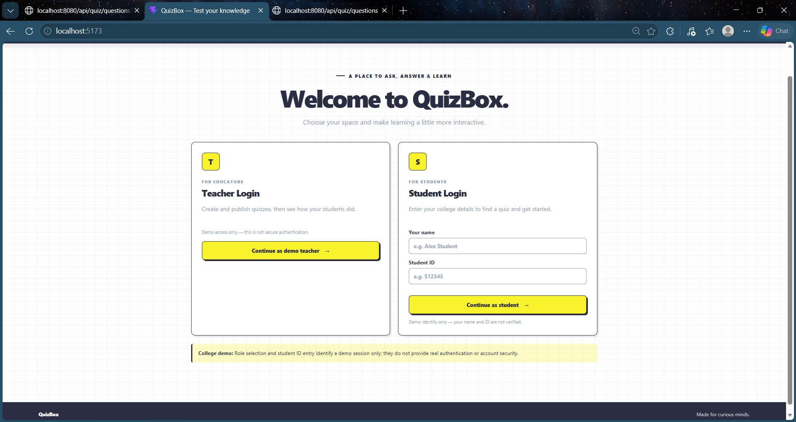
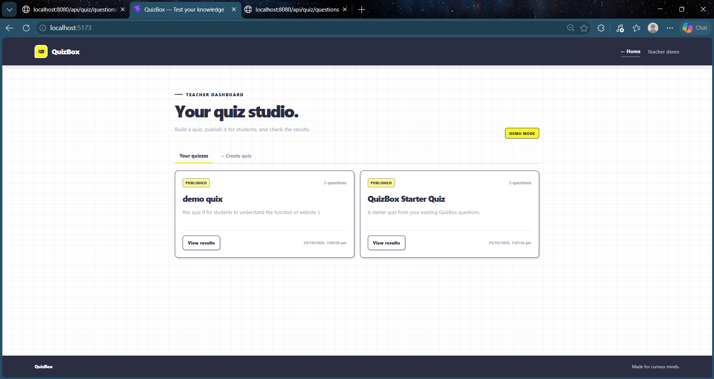
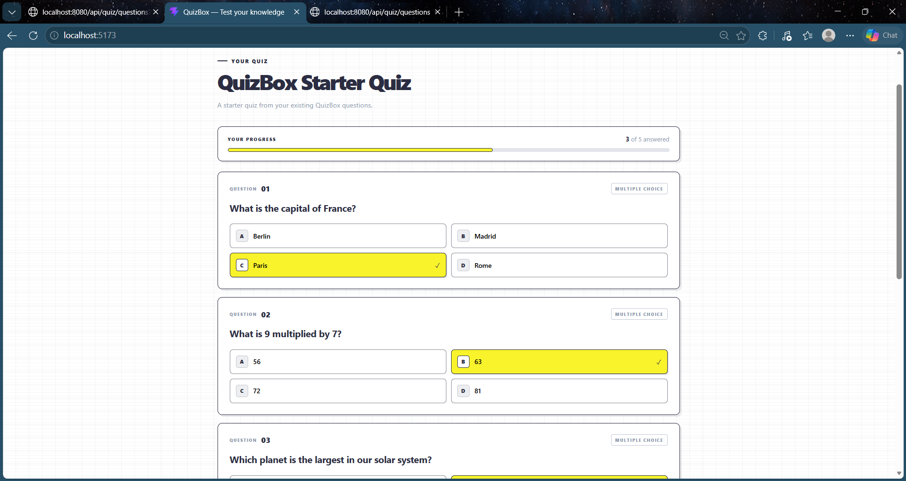
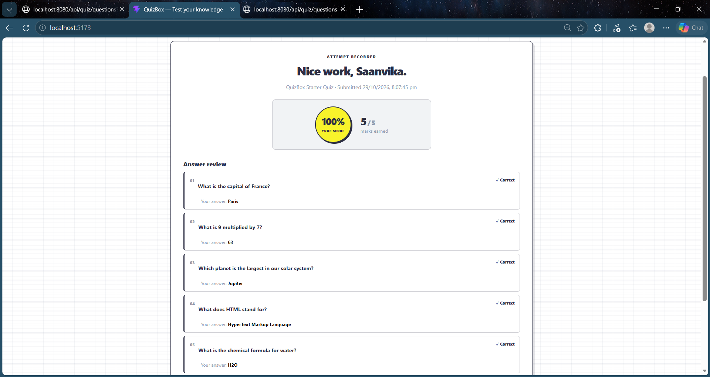

<div align="center">


### ✦ Your little corner of quizzes, learning & fun ✦

*A full-stack online quiz platform where teachers create quizzes and students test their knowledge.*

<br/>

<a href="https://github.com/msaanvika2017/QuizBox">
  
</a>


<br/><br/>

**Made with ☕, creativity & a little bit of code.**

</div>

---

## 💌 ୨୧ Welcome to QuizBox!

> 🎯 Learning doesn't have to be boring. QuizBox makes quizzes simple, interactive, and fun!

QuizBox is a full-stack web application designed to bring teachers and students together in one place.

Teachers can create and publish quizzes, while students can attempt available quizzes, submit their answers, view their scores, and review correct answers.

The goal? **Make learning feel less like a task and more like a little challenge!** ✨

---

## 🎨 ୨୧ The QuizBox Colour Story

Our visual identity combines bold contrast with a playful pop of electric yellow.

<div align="center">

|                                            Colour                                           |  Hex Code | Personality                         |
| :-----------------------------------------------------------------------------------------: | :-------: | :---------------------------------- |
|             | `#2B2D42` | 🌌 Bold navy — the foundation       |
|        | `#8D99AE` | 🩶 Calm blue-gray — the balance     |
|  | `#F8F32B` | 💛 Electric yellow — the fun        |
|            | `#FFFFFF` | 🤍 Clean white — the breathing room |
|            | `#000000` | 🖤 Black — the contrast             |

</div>

**The vibe:** Modern • Bold • Playful • Minimal • Student-friendly

---

## 🖥️ ୨୧ A Little Tour of the Website

> 📸 Replace the image paths below with screenshots saved in your repository.

### 01 — 🏠 The QuizBox Experience

↳ A welcoming interface designed to make quiz-taking straightforward.

<!-- Replace with your actual screenshot -->

<p align="center">
  
</p>

*♡ Clean layout → easy navigation → focused learning.*

### 02 — 👩🏻‍🏫 Teacher Dashboard

↳ Teachers can prepare quizzes by adding a title, questions, answer options, and the correct answers.

↳ Publish quizzes so students can access them.

<p align="center">
  
</p>

*♡ Create → Organise → Publish.*

### 03 — 📝 Student Quiz Page

↳ Students enter their details and access published quizzes.

↳ Select answers and submit the quiz when finished.

<p align="center">
  
</p>

*♡ Read → Choose → Submit.*

### 04 — 🏆 Results & Performance

↳ Students can view their scores and review correct answers after submission.

↳ Teachers can view recorded student results and performance.

<p align="center">
  
</p>

*♡ Submit → Score → Learn.*

---

## ✨ ୨୧ What Can You Do with QuizBox?

<table>
<tr>
<td width="50%" valign="top">

### 👩🏻‍🏫 For Teachers

✦ Create quizzes with custom titles.

✦ Add multiple-choice questions.

✦ Provide four answer options per question.

✦ Select the correct answer.

✦ Publish quizzes for students.

✦ View student scores and percentages.

</td>
<td width="50%" valign="top">

### 🧑🏻‍🎓 For Students

✦ Enter a name and student ID.

✦ Browse published quizzes.

✦ Answer multiple-choice questions.

✦ Submit answers for evaluation.

✦ View scores and correct answers.

✦ Learn from quiz results.

</td>
</tr>
</table>

---

## ⚙️ ୨୧ The Tech Behind the Magic

| Technology          | Role in QuizBox                                    |
| :------------------ | :------------------------------------------------- |
| ⚛️ **React**        | Builds the interactive user interface              |
| ⚡ **Vite**          | Frontend development server and build tool         |
| ☕ **Java**          | Backend programming language                       |
| 🍃 **Spring Boot**  | REST APIs and quiz business logic                  |
| 🗄️ **H2 Database** | Stores application data during the backend session |
| 🔗 **REST API**     | Connects the frontend and backend                  |
| 🎨 **CSS**          | Styling, layout, colours, and responsiveness       |
| 🧩 **Lucide React** | Interface icons                                    |

---

## 🚀 ୨୧ Run QuizBox on Your Computer

### Prerequisites

Make sure you have:

* Java installed
* Node.js and npm installed
* Git installed

### ① Clone the repository

```bash
git clone https://github.com/msaanvika2017/QuizBox.git
cd QuizBox
```

### ② Start the Spring Boot backend

Open a terminal in the project root.

If the project contains the Maven Wrapper (`mvnw.cmd`), run:

```powershell
.\mvnw.cmd spring-boot:run
```

Wait until Spring Boot starts successfully.

### ③ Start the React frontend

Open a second terminal:

```powershell
cd frontend
npm install
npm run dev
```

### ④ Open the website

Visit:

`http://localhost:5173`

Make sure the backend is running on port `8080` while using the application.

---

## 🗂️ ୨୧ Project Structure

```text
QuizBox/
│
├── src/
│   └── main/
│       ├── java/          → Spring Boot backend
│       └── resources/     → Backend configuration
│
├── frontend/
│   ├── src/
│   │   ├── App.jsx        → Main React application
│   │   ├── App.css        → Application styling
│   │   ├── api.js         → Backend API communication
│   │   └── index.css      → Global styles
│   │
│   ├── package.json
│   └── README.md
│
├── HELP.md
└── README.md
```

*Note: The exact backend package structure may contain additional controllers, services, DTOs, and tests.*

---

## 💡 ୨୧ A Few Important Notes

* 🔐 **Demo access:** Teacher access and student name/ID entry are demonstration features, not production-grade authentication.
* 💾 **Database:** The current H2 in-memory database loses stored records when the backend stops.
* 🌐 **Local development:** The frontend and backend must both be running for the complete application to work.

---

## 🌷 ୨୧ What I Learned

Building QuizBox is an opportunity to explore:

* Full-stack application development.
* Connecting React to Spring Boot REST APIs.
* Designing and validating multiple-choice quizzes.
* Backend answer evaluation and score calculation.
* Displaying student results.
* Working with a database and organising a software project.

---

## 🔮 ୨୧ Future Ideas

♡ Persistent database storage.

♡ Secure teacher and student authentication.

♡ Quiz timers and countdowns.

♡ Categories, difficulty levels, and randomised questions.

♡ Leaderboards and progress analytics.

♡ More customisation for quiz creators.

---

<div align="center">

## 💛 Thanks for visiting QuizBox!

**Create something. Challenge yourself. Keep learning.**

Made with ♡ by **Saanvika**

<a href="https://github.com/msaanvika2017">
  
</a>

<br/><br/>

*✧˚ · . The next question could be your favourite one. . · ˚✧*


</div>
